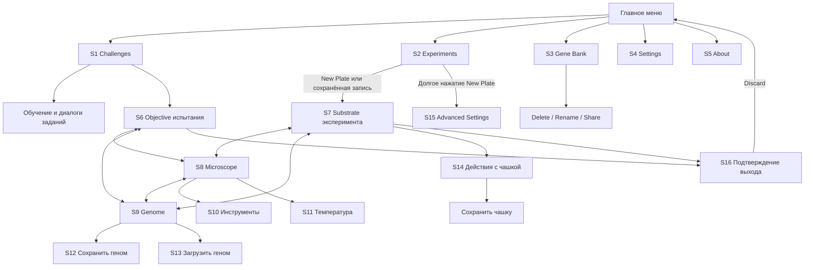

# 02. Карта экранов и переходов

Эта карта описывает Android v103 в исследованном профиле. Полный список пользовательских сценариев — [документ 01](01-player-journeys.md).

## Навигационный каркас

`Home` — логический контейнер вкладок, отдельный стартовый экран между ними не наблюдался. Меню инструментов, температуры и действий с чашкой доступны через верхнюю панель лаборатории, в том числе вне Microscope. Стрелки на диаграмме показывают основные маршруты, а не исчерпывающий список всех возможных переключений.

## Каталог экранов

| ID | Экран и назначение | Главные элементы | Контекст / состояние | Доказательство |
| --- | --- | --- | --- | --- |
| S1 | Challenges: выбрать учебную или игровую задачу | Прокручиваемые строки: название, статус, сложность, награда или prerequisite | Выполнено / доступно, но не выполнено / требует предыдущего задания | E01, E42 |
| S2 | Experiments: создать или продолжить чашку | New Plate, пояснение о долгом нажатии, сохранённые записи с краткой статистикой | Без сохранений / с сохранениями | E20, E33 |
| S3 | Gene Bank: управлять сохранёнными конструкциями | Список имён; по нажатию меню Delete / Rename / Share | Исследована одна тестовая запись | E36 |
| S4 | Settings | Группы общих, звуковых и графических параметров | Текущее состояние контролов; изменение не проверено | E37–E38 |
| S5 | About | Version 103, авторство, внешняя помощь, благодарности и Donate | Проверен экран, не внешние действия | E39 |
| S6 | Objective | Исторический статус, счётчики, условие задачи, Hint, Spoiler | Для обучения — инструкция и повтор диалога; для Algae — условия испытания | E03, E07, E16 |
| S7 | Substrate | Возраст среды, количество клеток, количество пищи; Info; параметры и Gene Pool | Часть с параметрами прокручивается, статистика остаётся сверху | E21–E22, E34 |
| S8 | Microscope | Чаша, клетки; при диагностике выделение и нижняя панель | Пустая / с клеткой / с диагностикой | E05, E25–E26 |
| S9 | Genome | Предпросмотр, ползунок возраста, Save / Load / Edit mode, параметры режима | Верхняя часть с предпросмотром остаётся при прокрутке нижней панели | E08–E09, E27–E29 |
| S10 | Select tool | Названия и отличающиеся иконки инструментов | Algae: 2 пункта; эксперимент: 5 | E14, E24 |
| S11 | Substrate temperature | Freeze, Observe, Incubate | Текущий режим отражается цветом термометра; Slow motion выключен в настройках | E15, E16, E38 |
| S12 | Name your genome | Объяснение назначения, поле имени, Cancel / Save | При клавиатуре меняются размеры и положение диалога | E11–E13 |
| S13 | Load | Из микроскопа / стандартный / именованные записи | Загрузка подтверждается временным сообщением | E13–E14, E28 |
| S14 | Select action в эксперименте | Save plate… / Sterilize plate | В испытании аналогичная позиция панели имеет другое действие — перезапуск | E18, E23 |
| S15 | Advanced Settings | Лимиты клеток и пищи, диаметр, оценка памяти, Cancel / Start | Доступ через долгое нажатие New Plate | E35 |
| S16 | Discard current substrate? | Пояснение, Cancel / Discard | Появляется при включённой настройке ухода, даже сразу после сохранения | E06, E19, E32, E37 |

## Структура лаборатории

Вверху расположены имя текущего контекста и кнопка возврата. Справа — действие с чашкой, текущий инструмент и термометр. В обучении дополнительно виден `?`. Ниже — три вкладки:

- Испытание: **Objective / Microscope / Genome**.
- Эксперимент: **Substrate / Microscope / Genome**.

Таким образом, задача или условия среды находятся в одном навигационном слоте; наблюдение и конструирование остаются постоянными. Переключение вкладки — смена представления одной лаборатории, а не создание новой чашки. Сохранение текущего состояния при всех возможных переходах требует отдельных тестов.

## Модальные и временные состояния

| Состояние | Как открывается | Как закрывается | Что важно перенести |
| --- | --- | --- | --- |
| Обучающее сообщение | Вход в обучение или переход к требуемой вкладке | OK | Ясное следующее действие, возможность повторения |
| Контекстная справка | Нажатие названия Split mass | OK | Объяснение причины и эффекта настройки |
| Hint | Кнопка на Objective | OK | Помощь по конкретной задаче |
| Меню выбора | Иконка или Load | Выбор пункта / возврат | Видимый смысл действия; контекстный набор пунктов |
| Именование | Save genome / Save plate | Сохранение или Cancel | Явный тип сохраняемого объекта |
| Подтверждение ухода | Возврат из лаборатории при настройке | Cancel / Discard | Возможность остаться; нельзя путать уход с удалением сохранённой записи |
| Временное подтверждение | После сохранения / загрузки | Исчезает со временем | `Saved`, `Loaded new genome`; точная длительность не измерялась |

## Условия, которые нельзя потерять в веб-интерфейсе

1. **Контекст инструмента:** одинаковое касание чашки создаёт клетку или выбирает её для диагностики в зависимости от активного инструмента.
2. **Контекст скорости:** замороженную чашку можно подготовить до запуска; она не должна восприниматься как зависшая игра.
3. **Две области времени:** возраст предпросмотра генома и возраст текущей среды — разные величины.
4. **Разные операции чашки:** перезапуск испытания и сохранение/стерилизация эксперимента имеют разные последствия.
5. **Разные причины недоступности:** закрытый контент кампании, ограниченный набор инструментов уровня и ограничения производительности — самостоятельные состояния.
6. **Изменение компоновки:** клавиатура сдвигает кнопки диалогов; в вебе нужно проверять небольшие экраны и фокус полей.

Пункты этого раздела — выводы для проектирования. Они не задают обязательную пиксельную компоновку веб-версии.
